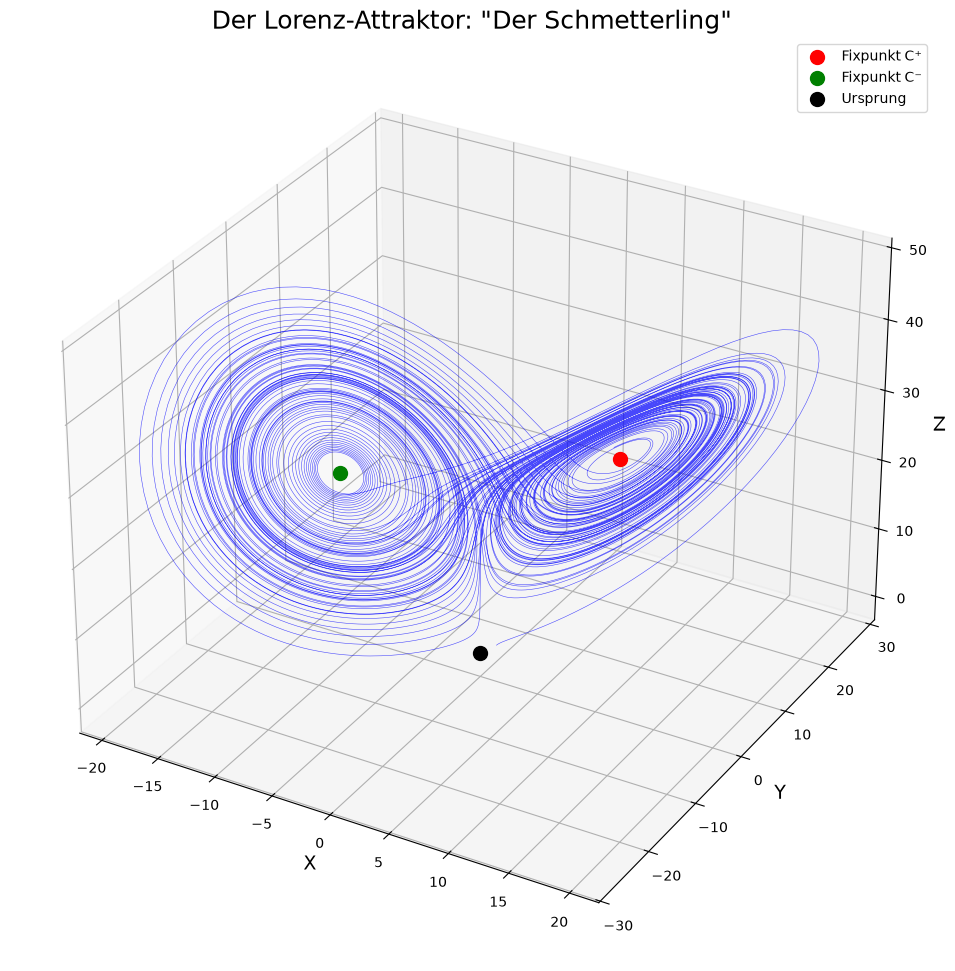

# Towards a Phenomenology of Deterministic Aperiodicity

[](https://github.com/eddievanhalensolo/phenomenology-of-deterministic-aperiodicity/actions/workflows/ci.yml)
[](LICENSE)

**Dynamische Systeme & Chaos:** Eine Lernreise in sieben Jupyter-Notebooks: von Differentialgleichungen als Vektorfeldern bis zu seltsamen Attraktoren. Mit lauffähigem Code, Abbildungen und Übungen in jedem Modul.

*A seven-notebook course on nonlinear dynamics, from ODEs as vector fields to strange attractors. The material is written in German.*



## Die Module

Die Notebooks enthalten ihre Ausgaben und lassen sich direkt auf GitHub lesen.

| # | Modul | Inhalt |
|---|-------|--------|
| 1 | [DGL als Vektorfeld](notebooks/01_dgl_als_vektorfeld.ipynb) | Phasenraum, Eindeutigkeit, Fluss |
| 2 | [Eindimensionale Systeme](notebooks/02_eindimensionale_systeme.ipynb) | Fixpunkte, Stabilität, Potentiale |
| 3 | [Zweidimensionale Systeme](notebooks/03_zweidimensionale_systeme.ipynb) | Phasenportraits, Klassifikation, Nullklinen |
| 4 | [Nichtlineare Systeme](notebooks/04_nichtlineare_systeme.ipynb) | Linearisierung, Grenzzyklen, Poincaré-Bendixson |
| 5 | [Bifurkationen](notebooks/05_bifurkationen.ipynb) | Qualitative Übergänge, Hopf, Periodenverdopplung |
| 6 | [Chaos](notebooks/06_chaos.ipynb) | Lorenz, Lyapunov-Exponenten, Schmetterlingseffekt |
| 7 | [Seltsame Attraktoren](notebooks/07_seltsame_attraktoren.ipynb) | Fraktale Dimension, Hénon, Rössler |

## Die Lernreise

```
[1] DGL als Vektorfeld
         ↓
[2] 1D-Systeme (kein Chaos möglich!)
         ↓
[3] 2D-Systeme (immer noch kein Chaos)
         ↓
[4] Nichtlinearität & Grenzzyklen
         ↓
[5] Bifurkationen
         ↓
[6] Chaos (≥3D oder diskret)
         ↓
[7] Seltsame Attraktoren
```

## Setup

```bash
git clone https://github.com/eddievanhalensolo/phenomenology-of-deterministic-aperiodicity.git
cd phenomenology-of-deterministic-aperiodicity
python3 -m venv .venv
source .venv/bin/activate
pip install -r requirements.txt
jupyter notebook notebooks/
```

Entwickelt und getestet mit Python 3.14. Die CI prüft außerdem Python 3.10.

## Struktur

```
phenomenology-of-deterministic-aperiodicity/
├── notebooks/         # Die sieben Module
├── utils/             # Optionale Bibliothek (siehe unten)
│   ├── plotting.py        # Visualisierungsfunktionen
│   └── integration.py     # Numerische Werkzeuge
├── tests/             # Tests für utils/
└── requirements.txt
```

Die Notebooks sind eigenständig und bringen ihren Code selbst mit. `utils/` ist eine optionale Sammlung der gleichen Werkzeuge zum Weiterarbeiten, etwa für die Übungen. Vom Hauptverzeichnis aus:

```python
from utils import plot_phase_portrait, lyapunov_exponents_flow
```

Die Tests prüfen die numerischen Werkzeuge gegen analytisch bekannte Ergebnisse:

```bash
pip install pytest
python -m pytest tests
```

## Kernkonzepte

- **DGL = Vektorfeld**: Jede DGL definiert einen Fluss im Phasenraum
- **Phasenraum-Denken**: Qualitative Analyse ohne explizite Lösungen
- **Linearisierung**: Lokal verhält sich alles wie linear (Hartman-Grobman)
- **Bifurkationen**: Qualitative Übergänge bei Parameteränderung
- **Chaos**: Determinismus ohne Vorhersagbarkeit (λ > 0)
- **Fraktale Dimension**: Die Geometrie seltsamer Attraktoren

## Literatur

- **Strogatz**: "Nonlinear Dynamics and Chaos" (das Standardwerk)
- **Gleick**: "Chaos: Making a New Science" (populärwissenschaftlich)
- **Lorenz**: "The Essence of Chaos" (vom Entdecker selbst)
- **Grassberger & Procaccia**: "Characterization of Strange Attractors" (Phys. Rev. Lett. 50, 1983; zur Korrelationsdimension in Modul 7)

## Lizenz

[MIT](LICENSE)
